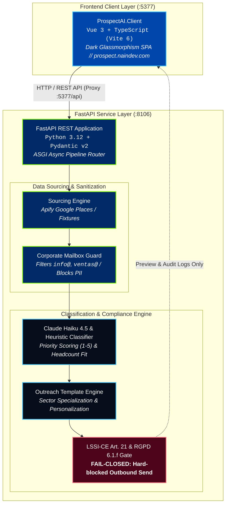

<picture>
  <source media="(prefers-color-scheme: dark)" srcset="docs/assets/banner-dark.svg">
  <source media="(prefers-color-scheme: light)" srcset="docs/assets/banner-light.svg">
  
</picture>

# NainProspect (ProspectAI) — B2B Prospecting & Compliance Gateway

[](README.md)
[](README.es.md)
[](https://github.com/Nain9Dev/ProspectAI/actions/workflows/ci.yml)
[](https://prospect.naindev.com/)
[](https://status.naindev.com)
[](https://github.com/Nain9Dev/engineering-handbook)
[](https://github.com/Nain9Dev/engineering-handbook/blob/main/governance/zero-cost-philosophy.md)
[](specs/001-modernization-and-showcase/tasks.md)
[](tests/test_architecture.py)
[](https://prospect.naindev.com/)
[](docs/02-business-rules.md)

**Demo Online Interactiva:** [https://prospect.naindev.com/](https://prospect.naindev.com/)

**NainProspect** es una pasarela desacoplada de prospección B2B, enriquecimiento con IA y verificación determinista de conformidad legal dentro del ecosistema de servicios de [naindev.com](https://www.naindev.com).

Localiza empresas desde registros públicos (Apify Google Places o generadores sintéticos), extrae buzones de rol corporativo (`info@`, `contacto@`, `ventas@`), clasifica sector, tamaño de plantilla (objetivo 50-500 empleados) y prioridad (1-5) mediante Claude Haiku 4.5, y genera plantillas de outreach con pie legal inmutable.

> **Compuerta Legal Activa**: Por imperativo del artículo 21 de la LSSI-CE y el artículo 6.1.f del RGPD, el envío automático de correos en frío está técnicamente bloqueado en el código. El sistema se detiene en previsualización y simulación determinista.

---

## Matriz de Verificación en 60 Segundos

```powershell
# 1. Ejecutar la suite de pruebas unitarias e integracion (16/16 passed)
.\venv\Scripts\pytest tests/ -v

# 2. Compilar el cliente frontend Vue 3 + TypeScript (strict mode, 0 errors)
npm --prefix ProspectAI.Client run build

# 3. Lanzar la prueba CLI con 10 leads y salida por consola
.\venv\Scripts\python.exe test_pipeline.py
```

---

## Puertos y Arquitectura de Servicios

Registrado en `D:\Development\Tools\dev-ports.json`:

| Servicio | Runtime | Puerto Local | Documentación / URL |
| -------- | ------- | ------------ | ------------------- |
| **ProspectAI.Client** | Vue 3 + TypeScript (Vite 6) | `5377` | `http://localhost:5377` |
| **FastAPI Backend** | Python 3.12 + Pydantic v2 | `8106` | `http://localhost:8106/docs` (Scalar) |
| **Health Probe** | ASGI Health Endpoint | `8106` | `http://localhost:8106/health` |



---

## Ejecución Local

### 1. Backend FastAPI (Puerto 8106)
```powershell
.\venv\Scripts\uvicorn src.nainprospect.main:app --port 8106 --reload
```
Accede a la documentación interactiva OpenAPI en:
`http://localhost:8106/docs`

### 2. Frontend SPA (Puerto 5377)
```powershell
cd ProspectAI.Client
npm run dev
```
Accede al panel interactivo de prospección en:
`http://localhost:5377`

### 3. Ejecución por Lotes Programada (GitHub Actions / CLI)
El script CLI original y el workflow programado `.github/workflows/prospeccion.yml` se mantienen 100% operativos:
```powershell
python pipeline.py --query "empresas de logistica en Madrid" --limite 10
```

---

## Garantías de Conformidad Legal (RGPD & LSSI-CE)

1. **Descarte de personas físicas**: La capa de ingesta (`compliance.py`) elimina cualquier dirección que no coincida con prefijos de rol de empresa (`info`, `contacto`, `ventas`, `soporte`, `comercial`, etc.).
2. **Pie legal inmutable**: El pie de los correos comerciales no lo redacta la IA; se construye determinísticamente a partir de las variables societarias (`SENDER_COMPANY_NAME`, `SENDER_LEGAL_ID`, `SENDER_ADDRESS`, `SENDER_OPTOUT_EMAIL`).
3. **Bloqueo técnico de envío**: No hay código de envío SMTP/API automático. La función `assert_outbound_send_blocked()` bloquea cualquier intento de despacho en caliente.
4. **Protección de datos en Git**: Los CSVs y datos enriquecidos se guardan en `data/` y están excluidos del repositorio en `.gitignore`.

---

## Estructura del Proyecto

```
ProspectAI/
├── AGENTS.md                          Guía técnica para desarrollo y convenciones
├── CLAUDE.md                          Restricciones arquitecturales y compliance
├── SECURITY.md                        Política de seguridad y aislamiento RGPD
├── pytest.ini                         Configuración de pruebas con pythonpath
├── requirements.txt                   Dependencias LTS de Python
├── config.py                          Configuración central y detección de modo
├── pipeline.py                        Orquestador CLI por lotes
├── test_pipeline.py                   Prueba de concepto por consola (10 leads)
├── docs/                              Documentación numerada por fases
├── src/nainprospect/                  Backend desacoplado FastAPI
│   ├── api/routes.py                  Endpoints REST
│   ├── domain/models.py               Esquemas Pydantic v2
│   ├── engine/                        Motores de sourcing, compliance y plantillas
│   └── main.py                        Punto de entrada ASGI (puerto 8106)
├── tests/                             Suite Pytest (16 tests)
└── ProspectAI.Client/                 Frontend SPA Vue 3 + TypeScript (puerto 5377)
    ├── src/components/                Componentes de control, tabla y previsualización
    ├── src/locales/                   Módulo i18n reactivo (es-ES / en-US)
    ├── src/services/api.ts            Cliente HTTP tipado
    └── vite.config.ts                 Configuración Vite con puerto 5377
```
