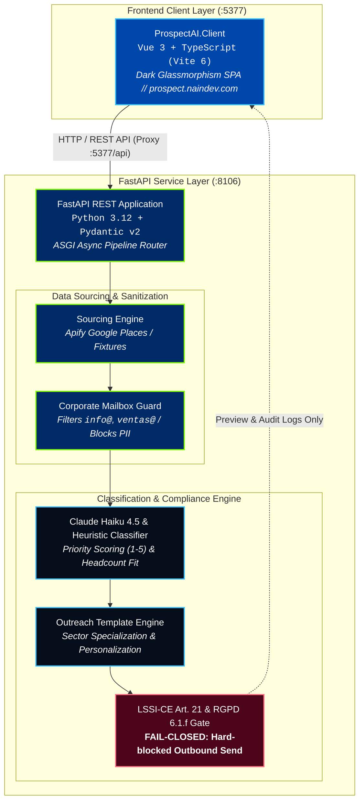

<picture>
  <source media="(prefers-color-scheme: dark)" srcset="docs/assets/banner-dark.svg">
  <source media="(prefers-color-scheme: light)" srcset="docs/assets/banner-light.svg">
  
</picture>

# NainProspect (ProspectAI) — B2B Prospecting & Compliance Gateway

[](README.md)
[](README.es.md)
[](https://github.com/Nain9Dev/ProspectAI/actions/workflows/ci.yml)
[](https://prospect.naindev.com/)
[](https://status.naindev.com)
[](https://github.com/Nain9Dev/engineering-handbook)
[](https://github.com/Nain9Dev/engineering-handbook/blob/main/governance/zero-cost-philosophy.md)
[](specs/001-modernization-and-showcase/tasks.md)
[](tests/test_architecture.py)
[](https://prospect.naindev.com/)
[](docs/02-business-rules.md)

**Interactive Live Demo:** [https://prospect.naindev.com/](https://prospect.naindev.com/)

**NainProspect** is a decoupled B2B prospecting, AI enrichment, and deterministic legal compliance gateway within the [naindev.com](https://www.naindev.com) service ecosystem.

It sources company data from public registries (Apify Google Places or synthetic fixtures), extracts corporate role mailboxes (`info@`, `contacto@`, `ventas@`), classifies business sector, headcount band (target 50-500 employees), and priority score (1-5) via Claude Haiku 4.5, and generates compliant outreach drafts with an immutable legal footer.

> **Active Safety Gate**: By mandate of Spanish LSSI-CE Article 21 and GDPR Article 6.1.f, automated cold emailing is technically blocked in the codebase. The pipeline stops deterministically at preview and audit simulation.

---

## 60-Second Verification Matrix

```powershell
# 1. Run unit, integration, and architecture test suite (16/16 passed)
.\venv\Scripts\pytest tests/ -v

# 2. Build Vue 3 + TypeScript frontend client (strict mode, 0 errors)
npm --prefix ProspectAI.Client run build

# 3. Execute CLI pipeline test with 10 synthetic leads
.\venv\Scripts\python.exe test_pipeline.py
```

---

## Ports and Service Architecture

Registered in `D:\Development\Tools\dev-ports.json`:

| Service | Runtime | Local Port | Documentation / URL |
| ------- | ------- | ---------- | -------------------- |
| **ProspectAI.Client** | Vue 3 + TypeScript (Vite 6) | `5377` | `http://localhost:5377` |
| **FastAPI Backend** | Python 3.12 + Pydantic v2 | `8106` | `http://localhost:8106/docs` (Scalar) |
| **Health Probe** | ASGI Health Endpoint | `8106` | `http://localhost:8106/health` |



---

## Local Execution

### 1. Backend FastAPI (Port 8106)
```powershell
.\venv\Scripts\uvicorn src.nainprospect.main:app --port 8106 --reload
```
Interactive OpenAPI / Scalar documentation is available at:
`http://localhost:8106/docs`

### 2. Frontend SPA (Port 5377)
```powershell
cd ProspectAI.Client
npm run dev
```
Interactive prospecting dashboard is available at:
`http://localhost:5377`

### 3. Scheduled Batch Execution (CLI / GitHub Actions)
The CLI script and scheduled workflow `.github/workflows/prospeccion.yml` remain fully operational:
```powershell
python pipeline.py --query "logistics companies in Madrid" --limite 10
```

---

## Legal Compliance Guarantees (GDPR & LSSI-CE)

1. **PII and Natural Person Mailbox Discard**: The ingestion layer (`compliance.py`) strictly eliminates any email address not matching standard corporate role prefixes (`info`, `contacto`, `ventas`, `soporte`, `comercial`, etc.).
2. **Deterministic Legal Footer**: Outreach footers are never generated stochastically by LLMs; they are constructed deterministically in code from statutory corporate attributes (`SENDER_COMPANY_NAME`, `SENDER_LEGAL_ID`, `SENDER_ADDRESS`, `SENDER_OPTOUT_EMAIL`).
3. **Fail-Closed Sending Barrier**: No automated SMTP or transactional API dispatch routines exist. The `assert_outbound_send_blocked()` function blocks any execution attempting outbound dispatch.
4. **Data Isolation**: Ingested datasets and generated CSV artifacts are persisted to `data/` and excluded from source control via `.gitignore`.

---

## Repository Structure

```
ProspectAI/
├── AGENTS.md                          Developer conventions and operational constraints
├── CLAUDE.md                          Architectural boundaries and compliance rules
├── SECURITY.md                        Security policy and GDPR isolation guarantees
├── pytest.ini                         Test configuration with pythonpath
├── requirements.txt                   Pinned LTS Python dependencies
├── config.py                          Central configuration and mode detector
├── pipeline.py                        CLI batch orchestrator
├── test_pipeline.py                   Console proof-of-concept runner (10 leads)
├── docs/                              Numbered lifecycle documentation
├── src/nainprospect/                  Decoupled FastAPI backend
│   ├── api/routes.py                  REST endpoints
│   ├── domain/models.py               Pydantic v2 schemas
│   ├── engine/                        Sourcing, compliance, and template engines
│   └── main.py                        ASGI application entrypoint (port 8106)
├── tests/                             Pytest suite (16 tests)
└── ProspectAI.Client/                 Vue 3 + TypeScript SPA (port 5377)
    ├── src/components/                Control, table, and preview modal components
    ├── src/locales/                   Reactive i18n module (es-ES / en-US)
    ├── src/services/api.ts            Typed HTTP client
    └── vite.config.ts                 Vite configuration pinned to port 5377
```
